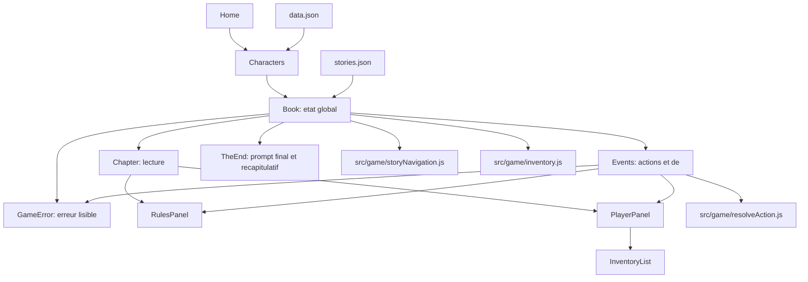

# Architecture - La maison de l'oubli

## Vue d'ensemble

L'application est un jeu narratif solo en React. Le joueur avance dans un graphe de chapitres, choisit des actions, effectue des jets de D100, recupere des objets simples, puis termine sur un prompt construit a partir de son historique.

L'architecture actuelle separe progressivement trois responsabilites :

- les donnees narratives ;
- la logique de jeu ;
- l'interface React.



## Arborescence utile

```text
choice_project/
  scripts/
    validate-story.mjs
  src/
    App.jsx
    main.jsx
    App.css
    contents/
      home.jsx
      book.jsx
      characters/
        characters.jsx
        data.json
      chapter/
        chapter.jsx
        stories.json
      events/
        choicecard.jsx
        events.jsx
        theend.jsx
      player/
        player-panel.jsx
        inventory-list.jsx
      rules/
        rules-panel.jsx
    game/
      inventory.js
      resolveAction.js
      storyNavigation.js
```

## Flux applicatif

### 1. Accueil

`src/contents/home.jsx` affiche l'ecran d'entree. Quand le joueur commence, l'application passe a `Characters`.

### 2. Selection personnage

`src/contents/characters/characters.jsx` lit `src/contents/characters/data.json`, affiche les personnages et transmet le personnage choisi a `Book`.

### 3. Orchestration de partie

`src/contents/book.jsx` porte l'etat global :

- personnage courant ;
- chapitre courant ;
- historique ;
- inventaire ;
- resultat precedent ;
- statut victoire/echec du dernier jet ;
- fond actif ;
- fin de partie.

`Book` ne construit plus directement toute la logique de choix. Il delegue une partie du travail a :

- `getDisplayChoices` dans `src/game/storyNavigation.js` ;
- `updateInventoryFromChoices` dans `src/game/inventory.js`.

### 4. Lecture d'un chapitre

`src/contents/chapter/chapter.jsx` affiche :

- le texte precedent ou le contexte narratif ;
- la question du maitre du jeu ;
- `RulesPanel` ;
- `PlayerPanel`.

### 5. Resolution d'un evenement

`src/contents/events/events.jsx` affiche les actions disponibles du chapitre courant.

Le cycle est :

1. le joueur choisit une action ;
2. `Events` recupere la caracteristique associee ;
3. le joueur lance le D100 ;
4. `resolveRoll` determine succes/echec ;
5. `getResultKey` produit une cle comme `d_w` ou `i_l` ;
6. `Book` recupere le texte narratif correspondant et affiche la suite.

### 6. Fin de partie

`src/contents/events/theend.jsx` affiche un prompt final compose a partir de l'historique et un recapitulatif simple de la partie. Le bouton copier utilise le presse-papiers navigateur. Le bouton rejouer demande confirmation avant de recharger la page.

`src/contents/errors/game-error.jsx` centralise les erreurs lisibles quand une donnee de chapitre ou d'action manque. L'objectif est d'eviter une page blanche et de donner un indice utile au developpeur.

## Couche `src/game`

La couche `src/game` contient la logique pure ou quasi pure. Elle doit rester independante de React autant que possible.

### `resolveAction.js`

Responsabilites :

- `rollD100()` : genere un nombre de 1 a 100.
- `resolveRoll({ roll, stat })` : retourne `true` si le jet est inferieur ou egal a la caracteristique.
- `getResultKey({ characteristic, success })` : transforme une caracteristique et un resultat en cle JSON.
- `getActionFromResultKey(resultKey)` : retrouve le type d'action associe a une cle de resultat.
- `getCharacterStat(character, characteristic)` : lit la valeur de caracteristique d'un personnage.

Exemples de cles :

- constitution reussie : `c_w`
- dexterite echouee : `d_l`
- intelligence reussie : `i_w`

### `storyNavigation.js`

Responsabilites :

- preparer les choix affichables pour `Book` ;
- normaliser chaque choix sous forme d'objet ;
- gerer les cas speciaux actuels comme le retour a la porte, la clef et la victoire ;
- ajouter certains choix a l'historique.

Structure d'un choix prepare :

```js
{
  id: "choice-9-0",
  label: "Atteindre le bureau",
  targetChapter: "9",
  type: "chapter",
  requiresConfirmation: true
}
```

### `inventory.js`

Responsabilites :

- ajouter un objet sans doublon ;
- retirer un objet ;
- determiner si la clef a ete trouvee ou utilisee ;
- recalculer l'inventaire a partir des choix deja faits.

Regle actuelle :

- la clef est obtenue quand le chapitre `10` a ete fait ;
- la clef est retiree quand le chapitre `19` a ete fait.

## Composants UI

### `ChoiceCard`

`ChoiceCard` est le composant d'action generique.

Il supporte :

- clic ;
- tap ;
- clavier avec Entree ou Espace ;
- etat `disabled` natif via un vrai bouton HTML.

Props principales :

- `content` : contenu affiche ;
- `onActivate` : action principale ;
- `onSwipeRight` : ancienne prop encore acceptee pour compatibilite d'appel, mais le swipe n'est plus actif ;
- `isDisabled` : desactive la carte ;
- `data` : contenu visuel supplementaire ;
- `choiceCss` : classe de taille ou variante.

## Diagrammes De Decision

Les diagrammes sources sont conserves dans `arbre_de_decision/` :

- `arbre_de_decision/arbre_de_décision.drawio` ;
- `arbre_de_decision/Diagramme sans nom.drawio`.

Ils servent de reference de conception, mais `stories.json` reste la source de verite executable. Quand un diagramme est modifie, il faut ensuite verifier que les transitions correspondantes existent toujours dans le JSON avec `npm run validate:story`.

### `PlayerPanel`

Affiche :

- nom du personnage ;
- type ;
- constitution ;
- dexterite ;
- intelligence ;
- icone principale ;
- inventaire via `InventoryList`.

### `InventoryList`

Affiche les objets sous forme de badges. Si l'inventaire est vide, le composant ne rend rien.

### `RulesPanel`

Affiche le rappel des regles de jet de caracteristique. Il est partage par `Chapter` et `Events`.

## Donnees narratives

### Chapitre

Un chapitre est un noeud de graphe dans `stories.json`.

Champs courants :

- `numero_chapitre`
- `card_context`
- `mj_question`
- `txt`
- `choix`
- `btn_choix`
- `choix_win`
- `btn_choix_win`
- `choix_loose`
- `btn_choix_loose`
- `btn_choix_sup`
- `actions`
- `c_w`, `c_l`, `d_w`, `d_l`, `i_w`, `i_l`

### Actions

Une action est definie par deux tableaux paralleles :

```json
{
  "actions": {
    "btn": ["Fouiller rapidement (d)."],
    "carac": ["dexterite"]
  }
}
```

L'index du bouton correspond a l'index de la caracteristique.

## Validation

Le script `scripts/validate-story.mjs` controle :

- unicite des `numero_chapitre` ;
- existence des chapitres cibles ;
- coherence de longueur entre `choix` et `btn_choix` ;
- coherence de longueur entre `choix_win` et `btn_choix_win` quand ce sont des tableaux ;
- coherence de longueur entre `choix_loose` et `btn_choix_loose` ;
- chapitres non references en warning.
- champs narratifs vides en warning ;
- placeholders et chapitres `draft` en warning ;
- regroupement des warnings par categorie.

Commande :

```bash
npm run validate:story
```

Commandes de verification standard :

```bash
npm run validate:story
npm run lint
npm run build
```

## Limites connues

- `Book` garde encore l'etat global, meme si les noms et le futur etat serialisable sont clarifies.
- Les ids de chapitres sont encore des chaines, mais la navigation utilise maintenant `getStoryById`.
- Les cas speciaux de navigation reposent sur des ids fixes centralises dans `storyConstants.js`.
- Le schema narratif n'est pas encore formalise par JSON Schema ou TypeScript.
- Les textes narratifs demandent encore une relecture complete.
- Les chapitres `draft` et non references demandent une decision narrative.

## Evolutions recommandees

1. Creer un reducer ou hook `useGameState`.
2. Creer `ChoiceList` et `StoryPanel`, puis enrichir `GameError` si de nouveaux types d'erreurs apparaissent.
3. Formaliser un schema JSON du scenario.
4. Finaliser la relecture narrative et decider le sort des chapitres brouillons.
5. Ajouter sauvegarde et reprise via `localStorage`.
