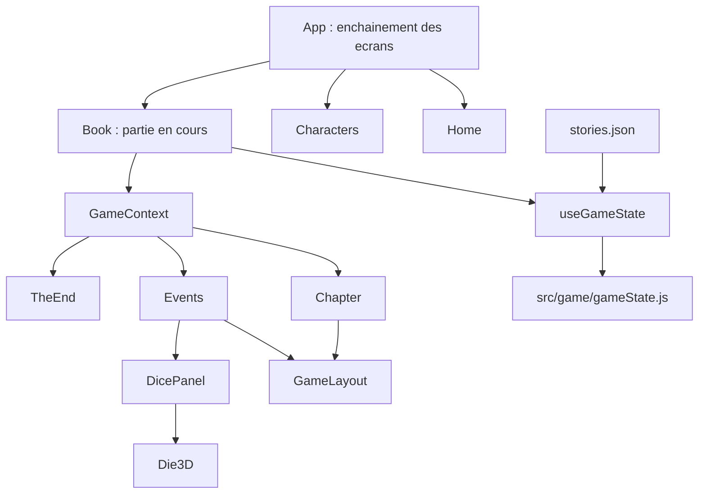

# Architecture - La maison de l'oubli

## Vue d'ensemble

Jeu narratif solo en React. Le joueur avance dans un graphe de chapitres, choisit des actions, lance un D100, recupere des objets, puis termine sur un prompt construit a partir de son historique.

Trois responsabilites sont separees :

- les donnees narratives (`stories.json`, `data.json`) ;
- la logique de jeu pure (`src/game`) ;
- l'interface React (`src/contents`, `src/hooks`, `src/styles`).



## Arborescence utile

```text
src/
  App.jsx                ecrans : accueil, personnages, partie
  main.jsx               polices, styles, ErrorBoundary
  contents/
    home.jsx
    book.jsx             expose la partie via GameContext
    chapter/             chapter.jsx, stories.json
    characters/          characters.jsx, data.json
    events/              choicecard, events, DicePanel, Die3D, icosahedron, theend
    game/                GameShell, GameLayout, ChoiceFooter, GameJournalModal
    player/              panneau, jauges, inventaire, journal
    rules/               rules-panel, rules-button
    ui/                  confirm-modal, mobile-hud, site-signature
    errors/              game-error, ErrorBoundary
  game/                  logique pure et tests
  hooks/                 useGameState, useGame, useClipboard, useScrollToTop
  styles/                tokens, base, layout, panels, cards, dice, screens
```

## Etat de partie

`useGameState` entoure le reducer de `gameState.js`. Il prepare les donnees derivees, la sauvegarde automatique et les actions de l'interface. Les composants lisent la partie avec `useGame()`.

## Cycle du de

Le cycle est dans l'etat sauvegarde, donc un rechargement reprend a la meme etape :

1. `SELECT_ACTION` : l'action choisie entre dans `selectedAction`.
2. `ROLL_DICE` : le tirage est fait par `useGameState`, le reducer le compare a la caracteristique et le place dans `pendingRoll`. Un second tirage est refuse.
3. `RESOLVE_ACTION_RESULT` : le texte de l'issue s'affiche, l'eventuel objet est obtenu et le cycle est vide.

`getResolutionPhase(state)` en deduit l'ecran a afficher. Le resultat est connu avant l'animation : `Die3D` ne fait que le reveler.

## Regles du scenario

Les regles narratives sont dans `stories.json`, pas dans le code : conditions de chaque choix, objets, decors. La liste des champs est dans `narrative_guide.md`.

## Styles

Pas de framework CSS. `tokens.css` declare les couleurs, polices et ombres ; les autres fichiers ne doivent pas en inventer de nouvelles. Le point de rupture mobile est a 760 px.

## Verification

```bash
npm run validate:story
npm run test
npm run lint
npm run build
```

`src/game/scenario.test.js` parcourt tous les etats atteignables du reducer : aucune impasse, tous les chapitres jouables atteints, les trois fins presentes.

## Limites connues

- Le titre parle d'une maison alors que le recit se passe dans un hotel.
- Les chapitres `draft` attendent une decision narrative.
- Le schema narratif n'est pas formalise par JSON Schema ou TypeScript.
- Il n'y a pas de test de composants React.
